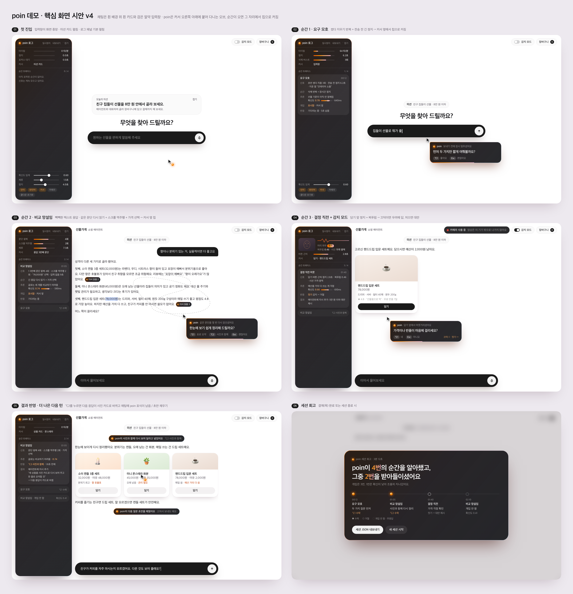

# ambition-us · poin

해커톤 프로젝트 레포입니다. 팀: 그랩크레딧타오자율

**poin**은 사용자의 언어·반언어·비언어 신호를 읽어 망설임의 순간을 포착하고, 대화 중간에 작은 제안으로 개입해 "더 나은 다음 턴"을 함께 만드는 레이어입니다. 이 데모는 채팅 쇼핑 에이전트 위에 poin을 얹었습니다. 개입은 에이전트 말풍선이 아니라 커서를 따라다니는 poin 칩으로, 사용자가 입력하기 전에 먼저 나타납니다.

- 데모: https://poin-demo.vercel.app
- 미션: "친구 집들이 선물을 8만 원 안에서 골라 보세요."



## 어떻게 동작하나

```
신호 수집 → 순간 감지(룰) → 의도 추론(LLM) → 커서 옆 칩 → 반응 → 다음 턴이 바뀜
```

| 신호 | 예시 |
|---|---|
| 언어 | 보낸 메시지, 썼다 지운 초안 |
| 반언어 | 타이핑 속도, 삭제 버스트, 전송 전 정지, 포커스 후 무입력 |
| 비언어(권한 불필요) | 커서 체류, 문단·카드 사이 왕복, 스크롤 역주행, 텍스트 선택 |
| 비언어(감지 모드, 카메라) | 끄덕임·젓기, 찌푸림, 거친 시선. 브라우저 안에서만 처리 |

## 순간 재현 방법

반응: `⌥1` 첫 번째 제안, `⌥2` 두 번째 제안, `Esc` 거절. 감지 모드가 켜져 있으면 끄덕이면 수락, 저으면 거절. 15초 동안 반응이 없으면 사라집니다(무응답도 기록).

| 순간 | 재현 | 칩 예시 | 결과 |
|---|---|---|---|
| 요구 모호 | 첫 메시지를 쓰다 지우기를 두어 번 하고 2.5초 멈춤 | "먼저 두 가지만 짧게 여쭤볼까요?" | 에이전트가 추천 전에 질문 2개 |
| 비교 망설임 | 텍스트 추천이 온 뒤 문단 사이를 마우스로 오가거나, 같은 문단을 다시 읽거나, 가격을 드래그 | "한눈에 보기 쉽게 정리해 드릴까요?" | ⌥1 표로 요약, ⌥2 사진 카드로 |
| 결정 직전 머뭇 | 담기 버튼 위에 1초 머물고 누르지 않음(감지 모드면 찌푸림도 근거) | "가격이나 반품이 마음에 걸리세요?" | 수락: 가격·반품 답변, 거절: 더 싼 대안 |
| 다음 턴 제안 | 에이전트 응답이 끝난 뒤 5초 동안 아무것도 안 함 | "예산 안에서 하나만 골라 드릴까요?" | 에이전트 행동 또는 입력창 초안 채우기 |

판단 기준(확신도 임계 0.40, 체류 1초, 정지 2.5초)은 왼쪽 로그 패널 아래 슬라이더로 바꿉니다. 쿨다운 15초, 세션당 최대 8회이고, 같은 종류를 연속 2번 거절하거나 무시하면 그 종류만 2분 쉽니다. 로그 패널은 `` ` `` 키로 접고 펼칩니다. 결제(목)를 끝내면 세션 회고 화면이 나옵니다.

## 로컬 실행

Node 24 이상이 필요합니다(테스트 스크립트가 `.ts`를 Node로 바로 실행).

```bash
npm install
cp .env.local.example .env.local   # ANTHROPIC_API_KEY 입력
npm run dev                        # http://localhost:3000
```

- 에이전트 모델: 기본 `claude-haiku-5-5`. `POIN_AGENT_MODEL=sonnet`이면 `claude-sonnet-5-5`.
- poin 추론 모델: `claude-haiku-5-5`.
- API 키는 서버 라우트에서만 읽고 클라이언트로 나가지 않습니다.

## 구조

| 경로 | 내용 |
|---|---|
| `src/components/chat/`, `src/app/api/chat/` | 채팅 에이전트(도구: search_catalog, show_products, add_to_cart, checkout), 목 카탈로그 24개 |
| `src/poin/signals/`, `moments/`, `engine/`, `ui/` | 신호 수집, 순간 감지 룰, 추론 호출과 prefetch, 칩·반응·결과 |
| `src/app/api/poin/infer/` | 의도 추론 API |
| `src/poin/panel/` | 운영 로그 패널, 세션 회고 |
| `src/poin/sense/` | 감지 모드(MediaPipe FaceLandmarker) |
| `src/poin/types.ts`, `src/poin/store.ts`, `CONTRACTS.md` | 모듈 사이 계약 |
| `src/i18n/` | UI 문구 전부. 영어로 바꿀 때는 같은 키로 파일 추가 |
| `design/board.html` | 화면 시안(v4, 이전 버전은 `board.v1~v3.html`) |

## 검증

```bash
node scripts/test-detector.ts   # 순간 감지 룰
node scripts/test-gestures.ts   # 끄덕임·젓기·찌푸림 판정
node scripts/e2e-aside.mjs      # Aside 브라우저 E2E (개발 서버 :3100, Aside CLI 필요)
```

## 로그

- 개발: 클라이언트와 서버 로그가 `logs/poin-YYYYMMDD.jsonl` 한 파일로 모입니다.
- 프로덕션: 클라이언트 로그는 그 탭의 sessionStorage에만, 서버 로그는 호스팅 런타임 로그에만 남습니다.
- 로그 패널의 "내보내기"로 세션 JSON(트레이스·신호·로그)을 받을 수 있습니다.

## 개인정보

첫 방문 때 동의 모달로 무엇을 읽는지 알립니다. 동의하지 않으면 poin 신호 읽기가 꺼진 채로 채팅만 쓸 수 있습니다. 카메라 영상은 브라우저 밖으로 나가지 않고 각도·수치만 씁니다. 결제는 연습용입니다.

## 알려진 한계

- 공개 배포에 API 호출 제한·인증이 없습니다.
- "다음 턴 제안"의 에이전트 지시문은 LLM이 쓰고 서버가 검증합니다. 바꿔 말한 프롬프트 주입은 막지 못합니다(고정 목록 방식으로 바꿀 예정).
- 감지 모드의 찌푸림·시선 임계값은 실제 얼굴로 충분히 보정하지 않았습니다.
